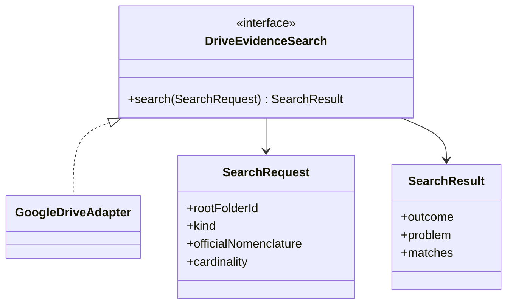

# Repositorio-BackendTEMA-

## Servicios M1

El módulo `service` expone `GET/POST /api/v1/services`, `GET/PUT /api/v1/services/{serviceId}`
y `GET /api/v1/services/{serviceId}/verifiable-processes`. Usa las tablas existentes
`services` y `service_process_versions`; no se requiere una migración nueva.
`GET /api/v1/services?page=0&size=20` requiere una sesión autenticada y devuelve
`items` y `page`. Solo el Administrador puede crear o editar. `PUT` requiere la
`revision` actual y responde `409` si hubo otra edición.

Un servicio puede crearse sin fuentes mientras se configuran las integraciones.
Cuando el request incluye `driveFolderId` o `redmineProjectId`, el backend exige
un `ServiceSourceResolver` que lea la fuente con la identidad técnica y devuelva
su nombre; sin acceso responde `503` y no persiste el servicio. El adaptador de
Drive implementa esta lectura; la de Redmine queda para 6.2.1. El endpoint
`GET /api/v1/services/{serviceId}/tickets` ya está preparado para consumir
`ServiceTicketSearch`; sin proyecto Redmine o sin adaptador responde `503`.
No se generan nombres ni tickets ficticios en el perfil de ejecución normal.

## Disponibilidad general de fuentes M1

`GET /api/v1/integrations/status` devuelve el último estado conocido de Google
Drive y Redmine. `POST /api/v1/integrations/test` solicita una prueba nueva de
lectura para cada fuente. Ambos endpoints requieren un JWT de Administrador y
devuelven `source`, `status`, `checkedAt` y un `message` sin datos sensibles.
El estado general no comprueba el acceso a una carpeta, proyecto o ticket de
un servicio particular.

La variable opcional `TEMA_INTEGRATION_PROBE_TIMEOUT` controla el tiempo máximo
por fuente en formato ISO-8601 (`PT3S` por defecto; máximo `PT30S`). No se
necesitan variables de Drive ni Redmine para arrancar el backend. El adaptador
de Drive se habilita por separado; Redmine seguirá en `NOT_CONFIGURED` hasta
6.2.1. Configurar credenciales por sí solo nunca produce `AVAILABLE`: ese
estado exige una lectura exitosa.

## Conector Google Drive de solo lectura (TC-163)

El backend arranca con `TEMA_DRIVE_ENABLED=false` por defecto. Para probar Drive,
habilitar la API de Google Drive en el proyecto de prueba, dar acceso de lectura
a una carpeta de prueba a la identidad técnica y configurar las credenciales
mediante Application Default Credentials. En desarrollo local se puede indicar
la ruta de un archivo de credenciales **fuera del repositorio** con
`GOOGLE_APPLICATION_CREDENTIALS`; no copiar el JSON a `src/main/resources` ni
registrarlo en Git. La identidad necesita el alcance `drive.metadata.readonly`.

Con `TEMA_DRIVE_ENABLED=true`, `POST /api/v1/integrations/test` ejecuta una
lectura real; `GET /api/v1/integrations/drive/folders?query=&page=0&size=20`
lista carpetas para el Administrador. Al guardar `driveFolderId` en un servicio,
el backend comprueba el ID y toma el nombre desde Drive. Sin credenciales o
sin acceso, el selector y el guardado informan un error seguro y no simulan
disponibilidad. `TEMA_DRIVE_TIMEOUT` usa una duración ISO-8601 (`PT5S` por
defecto). `TEMA_DRIVE_API_BASE_URL` solo se cambia en pruebas con un servidor
HTTP simulado. Las credenciales no se muestran en respuestas ni en logs.

El contrato actual exige totales de paginación. Drive solo entrega
`nextPageToken`, así que el selector recorre las páginas accesibles y calcula
los totales antes de paginar. Está pensado para un Drive de prueba acotado;
si se supera el límite de 100 páginas, la consulta falla sin entregar una
lista parcial como si fuese completa.

## Búsqueda de evidencias de Drive (TC-164)

`DriveEvidenceSearch` es una operación interna para M2; no agrega un endpoint
público. Recibe el ID de la carpeta configurada para el servicio, el tipo
`DOCUMENT` o `FOLDER`, la nomenclatura oficial y la cardinalidad `ONE` o
`MULTIPLE`. Solo lee metadatos dentro de esa carpeta y sus subcarpetas. Un
nombre se compara exactamente; una ruta se compara desde la carpeta del
servicio. No abre archivos ni sigue accesos directos.

El resultado distingue `FOUND`, `ABSENT`, `AMBIGUOUS` y `NOT_CHECKABLE`.
`ABSENT` se devuelve solo tras completar todas las páginas y subcarpetas.
Errores de autenticación, permisos, timeout, respuestas incompletas y límites
de recorrido producen `NOT_CHECKABLE`; no equivalen a incumplimiento. La
operación limita el recorrido a 100 páginas, 1000 carpetas, 100000 elementos
y 30 segundos. M2 decidirá después la aplicabilidad y traducirá el resultado
a un estado de verificación. No se requiere migración ni credenciales nuevas:
se reutiliza la configuración de Drive descrita arriba.

El futuro verificador convierte los tipos y cardinalidad de la expectativa
publicada de M1 al `SearchRequest`, y traduce el `SearchResult` a su propio
resultado. `integration` no depende del módulo `verification`.
