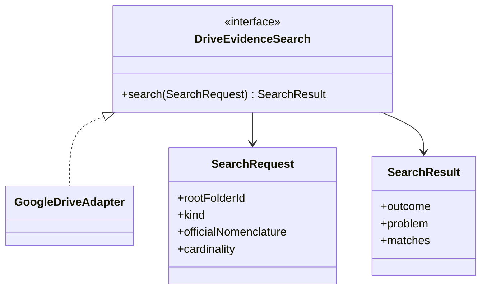

# Repositorio-BackendTEMA-

## Servicios M1

El módulo `service` expone `GET/POST /api/v1/services`, `GET/PUT /api/v1/services/{serviceId}`
y `GET /api/v1/services/{serviceId}/verifiable-processes`. Usa las tablas existentes
`services` y `service_process_versions`; no se requiere una migración nueva.
`GET /api/v1/services?page=0&size=20` requiere una sesión autenticada y devuelve
`items` y `page`. Solo el Administrador puede crear o editar. `PUT` requiere la
`revision` actual y responde `409` si hubo otra edición.

Un servicio puede crearse sin fuentes mientras se configuran las integraciones.
Cuando el request incluye `driveFolderId` o `redmineProjectId`, el backend exige
un `ServiceSourceResolver` que lea la fuente con la identidad técnica y devuelva
su nombre; sin acceso responde `503` y no persiste el servicio. Los adaptadores
de Drive y Redmine implementan esta lectura y validan el proyecto o carpeta real
antes de guardar el servicio. El endpoint `GET /api/v1/services/{serviceId}/tickets`
usa `ServiceTicketSearch` con el proyecto asociado al servicio y responde `503`
si no existe un proyecto Redmine validado o si el conector no está disponible.
No se generan nombres ni tickets ficticios en el perfil de ejecución normal.

## Disponibilidad general de fuentes M1

`GET /api/v1/integrations/status` devuelve el último estado conocido de Google
Drive y Redmine. `POST /api/v1/integrations/test` solicita una prueba nueva de
lectura para cada fuente. Ambos endpoints requieren un JWT de Administrador y
devuelven `source`, `status`, `checkedAt` y un `message` sin datos sensibles.
El estado general no comprueba el acceso a una carpeta, proyecto o ticket de
un servicio particular.

La variable opcional `TEMA_INTEGRATION_PROBE_TIMEOUT` controla el tiempo máximo
por fuente en formato ISO-8601 (`PT3S` por defecto; máximo `PT30S`). No se
necesitan variables de Drive ni Redmine para arrancar el backend. Configurar
credenciales por sí solo nunca produce `AVAILABLE`: ese estado exige una lectura
exitosa. `NOT_CONFIGURED` sigue siendo el estado inicial para una fuente sin
configuración.

## Resumen de corrección y validación

Se corrigió la lectura individual de tickets de Redmine y la validación del historial para que el adaptador cumpla con el contrato de M2:

- Se incluye explícitamente `include=journals` al consultar el ticket.
- Si Redmine responde `404`, el backend lo transforma en `ApiException` de dominio y no en un error técnico escapado.
- El snapshot del ticket ahora conserva correctamente `statusId`, `statusName`, `closed`, `customFields` y `journals`.
- Los cambios del historial (`details`) se parsean y quedan accesibles como `JournalChange`.
- El estado cerrado solo se marca cuando Redmine lo señala explícitamente; si no hay esa señal, se devuelve como no determinado en lugar de inferirse por el nombre.

La validación quedó cubierta por tests de Redmine y la suite completa del backend ejecuta correctamente con `./mvnw test` sin fallos reportados en Surefire.

## Conector Redmine de solo lectura (TC-6.2.1)

El backend incluye un adaptador de lectura de Redmine para proyectos y tickets
que usa `GET` sobre la API REST JSON de Redmine, envía la clave en la cabecera
`X-Redmine-API-Key` y nunca la incluye en la URL, respuestas ni logs. El acceso
es solo de lectura: no crea proyectos ni tickets ni descarga adjuntos.

Para habilitarlo, configurar:

- `TEMA_REDMINE_ENABLED=true`
- `TEMA_REDMINE_API_BASE_URL=http://<host>:<port>/redmine`
- `TEMA_REDMINE_API_KEY=<clave del usuario del servicio>
- `TEMA_REDMINE_TIMEOUT=PT5S` (o un valor ISO-8601 válido entre 1 ms y 30 s)

`POST /api/v1/integrations/test` ejecuta una prueba real de lectura; un
resultado `AVAILABLE` exige que Redmine responda correctamente. Si la clave falla,
Redmine responde `401`; si se carece de permisos, `403`; si no es alcanzable o
falla la lectura, el estado queda en `UNAVAILABLE`.

El selector de proyectos expone `GET /api/v1/integrations/redmine/projects` para
Administradores, con paginación y la posibilidad de filtrar por nombre o
identifier. Al guardar o editar un servicio, se valida que el proyecto exista,
sea accesible y que el backend pueda devolver su nombre para persistir el `id`
real de Redmine junto con el nombre visible.

Antes de ejecutar una verificación de M2, `GET /api/v1/services/{serviceId}/tickets`
usa exclusivamente el proyecto Redmine guardado en el servicio, solicita
`status_id=*` para incluir tickets abiertos y cerrados y restringe los
resultados al proyecto asociado. La búsqueda por ID o asunto se hace dentro del
proyecto del servicio y la paginación se conserva con `totalElements`, `page` y
`size`.

La lectura individual de un ticket comprueba que `project.id` coincide con el
proyecto del servicio antes de devolver los metadatos, historial y campos
personalizados de Redmine. Eso permite a M2 analizar la evolución del ticket sin
mezclar tickets de otros proyectos.

En la consulta de detalle se incluye explícitamente `include=journals`; si la
respuesta de Redmine omite ese campo, la lectura del historial se considera
incompleta y no se interpreta como un historial vacío. El estado cerrado se
respetará solo cuando Redmine lo informe explícitamente; si no existe esa señal,
se devolverá como `desconocido` y nunca se deducirá por el nombre del estado.

Para M2, este snapshot debe usarse como evidencia de lectura, no como prueba de
cumplimiento por sí mismo: el backend recupera y organiza la información del
ticket y su historial, pero la decisión de si un cambio cumple una expectativa del
proceso se realizará en la capa de verificación. Antes de devolver el snapshot,
se valida que el ticket pertenezca al proyecto de Redmine asociado al servicio y
que cada consulta de detalle se refiera a un ticket concreto, sin mezclar datos
entre tickets o proyectos.

## Conector Google Drive de solo lectura (TC-163)

El backend arranca con `TEMA_DRIVE_ENABLED=false` por defecto. Para probar Drive,
habilitar la API de Google Drive en el proyecto de prueba, dar acceso de lectura
a una carpeta de prueba a la identidad técnica y configurar las credenciales
mediante Application Default Credentials. En desarrollo local se puede indicar
la ruta de un archivo de credenciales **fuera del repositorio** con
`GOOGLE_APPLICATION_CREDENTIALS`; no copiar el JSON a `src/main/resources` ni
registrarlo en Git. La identidad necesita el alcance `drive.metadata.readonly`.

Con `TEMA_DRIVE_ENABLED=true`, `POST /api/v1/integrations/test` ejecuta una
lectura real; `GET /api/v1/integrations/drive/folders?query=&page=0&size=20`
lista carpetas para el Administrador. Al guardar `driveFolderId` en un servicio,
el backend comprueba el ID y toma el nombre desde Drive. Sin credenciales o
sin acceso, el selector y el guardado informan un error seguro y no simulan
disponibilidad. `TEMA_DRIVE_TIMEOUT` usa una duración ISO-8601 (`PT5S` por
defecto). `TEMA_DRIVE_API_BASE_URL` solo se cambia en pruebas con un servidor
HTTP simulado. Las credenciales no se muestran en respuestas ni en logs.

El contrato actual exige totales de paginación. Drive solo entrega
`nextPageToken`, así que el selector recorre las páginas accesibles y calcula
los totales antes de paginar. Está pensado para un Drive de prueba acotado;
si se supera el límite de 100 páginas, la consulta falla sin entregar una
lista parcial como si fuese completa.

## Búsqueda de evidencias de Drive (TC-164)

`DriveEvidenceSearch` es una operación interna para M2; no agrega un endpoint
público. Recibe el ID de la carpeta configurada para el servicio, el tipo
`DOCUMENT` o `FOLDER`, la nomenclatura oficial y la cardinalidad `ONE` o
`MULTIPLE`. Solo lee metadatos dentro de esa carpeta y sus subcarpetas. Un
nombre se compara exactamente; una ruta se compara desde la carpeta del
servicio. No abre archivos ni sigue accesos directos.

El resultado distingue `FOUND`, `ABSENT`, `AMBIGUOUS` y `NOT_CHECKABLE`.
`ABSENT` se devuelve solo tras completar todas las páginas y subcarpetas.
Errores de autenticación, permisos, timeout, respuestas incompletas y límites
de recorrido producen `NOT_CHECKABLE`; no equivalen a incumplimiento. La
operación limita el recorrido a 100 páginas, 1000 carpetas, 100000 elementos
y 30 segundos. M2 decidirá después la aplicabilidad y traducirá el resultado
a un estado de verificación. No se requiere migración ni credenciales nuevas:
se reutiliza la configuración de Drive descrita arriba.



El futuro verificador convierte los tipos y cardinalidad de la expectativa
publicada de M1 al `SearchRequest`, y traduce el `SearchResult` a su propio
resultado. `integration` no depende del módulo `verification`.

## Regla de diseño de dominio — M2 preview

La implementación de `POST /api/v1/verifications/preview` protege las invariantes locales en `verification.domain`, mantiene las reglas que requieren múltiples objetos en servicios de dominio/aplicación y deja la traducción HTTP en `verification.api`. El detalle de ubicación y justificación está en `docs/7.1.1-domain-rule-placement.md`.


## 7.1.1 — Verification preview

Implemented `POST /api/v1/verifications/preview` as a read-only M2 use case. Domain invariants live in `verification.domain` and `process.domain`; cross-object validation is coordinated by `VerificationScopeResolver`; HTTP validation/error mapping stays in `verification.api`. The preview does not create runs or call external sources. See `docs/7.1.1-domain-rule-placement.md` and `docs/7.1.1-alignment-report.md`.

## 7.1.3 — Selección de tickets y cardinalidad

`POST /api/v1/verifications` vuelve a resolver el alcance y los grupos publicados, comprueba que `serviceRevision` siga vigente y valida la selección recibida sin inferir tickets por nombre ni reemplazar IDs elegidos. `ONE` requiere exactamente un ticket; `MULTIPLE`, uno o más. Cada ID se consulta mediante `RedmineTicketReader` y debe pertenecer al proyecto Redmine configurado para el servicio. Si falla la validación, no se crea la ejecución.

El run y sus filas de `verification_ticket_selections` se guardan en una transacción, conservando `run_id`, `group_id` y `ticket_id`. Las expectativas TICKET de una macroactividad comparten su grupo; los grupos de macroactividades distintas se validan por separado. Ver [docs/7.1.3-ticket-selection.md](docs/7.1.3-ticket-selection.md) para el flujo y las reglas completas.

## IA para aplicabilidad condicionada: Gemini

El proveedor predeterminado ahora es Gemini. Se conserva OpenAI como opción, pero no se
necesita su clave para ejecutar M2. Gemini solo interpreta evidencias `CASE_DEPENDENT`
cuando la regla programada no resuelve la aplicabilidad. Sin clave, el backend arranca
y devuelve `UNDETERMINED` para revisión humana.

```powershell
$env:TEMA_AI_PROVIDER='GEMINI'
$env:GEMINI_API_KEY='<clave-entregada-por-TEMA>'
# Opcional: $env:TEMA_GEMINI_MODEL='gemini-2.5-flash'
.\mvnw.cmd spring-boot:run
```

La clave debe permanecer fuera de Git. La configuración y los límites de seguridad están
en [docs/7.2.1-gemini-integration.md](docs/7.2.1-gemini-integration.md).
## Integración OpenAI para aplicabilidad de M2 (TC-178)

Si se selecciona `TEMA_AI_PROVIDER=OPENAI`, el backend usa el SDK oficial `openai-java` y la Responses API con salida
estructurada. La IA solo propone la aplicabilidad de evidencias marcadas
`CASE_DEPENDENT` cuando los datos estructurados no permiten resolverla. No
consulta Drive/Redmine ni decide si una evidencia cumple. El puerto interno
`ApplicabilityAiPort` queda disponible para el evaluador de TC-179; esta tarea
no agrega un endpoint público ni ejecuta automáticamente la IA en una revisión.

Para habilitar llamadas reales, configurar fuera del repositorio:

```powershell
$env:TEMA_AI_PROVIDER='OPENAI'
$env:TEMA_OPENAI_ENABLED='true'
$env:OPENAI_API_KEY='<clave-de-proyecto>'
$env:TEMA_OPENAI_MODEL='<modelo-compatible-con-structured-outputs>'
$env:TEMA_OPENAI_TIMEOUT='PT20S'
```

Sin clave, modelo o habilitación, el backend sigue iniciando y el puerto devuelve
`UNDETERMINED`, con un límite técnico para revisión humana. El timeout permitido
es mayor que cero y hasta 60 segundos; el SDK realiza como máximo un reintento
de transporte y hay un segundo intento solo para una respuesta estructurada
inválida. Las llamadas usan `store=false`; no se registran credenciales, prompts
ni datos de tickets en logs. La entrada se limita a 20.000 caracteres.

La ubicación de clases, el contrato interno y las responsabilidades de TC-179
están en `docs/7.2.1-openai-integration.md`. Las pruebas de esta tarea usan un
cliente simulado y no consumen la API real.

## M2 — verificación y persistencia de resultados

La capa M2 prepara el contexto de verificación, valida las selecciones de
tickets, resuelve la aplicabilidad y evalúa las evidencias con los componentes
disponibles. TC-176 agrega la persistencia de esas valoraciones y su consulta:

- `7.1.2` prepara el contexto con `VerificationContextLoader` y valida el
  proceso publicado, su asignación y la consistencia de los catálogos.
- `7.1.3` crea el run y persiste las selecciones de tickets validadas por grupo.
- `TC-178` integra OpenAI como propuesta opcional de aplicabilidad para los
  casos `CASE_DEPENDENT`; `TC-179` aplica la política determinista y su fallback.
- `TC-176` expone `VerificationResultPort` para guardar valoraciones evaluadas y
  consultar el progreso persistido. El adaptador PostgreSQL valida el alcance y
  las selecciones del run, persiste resultado, aplicabilidad, limitaciones y
  referencias de evidencia en una transacción, y trata las repeticiones
  idénticas como idempotentes. Una valoración distinta para la misma unidad
  produce conflicto.
- `GET /api/v1/verifications/{runId}/results?page=0&size=20` devuelve resultados
  paginados solo cuando el run está `COMPLETED`; la consulta tiene orden estable
  y carga las relaciones en lote. La migración V6 separa las limitaciones de
  aplicabilidad de las limitaciones generales del resultado.
- `GET /api/v1/verifications?serviceId={uuid}&page=0&size=20` (TC-182) lista
  ejecuciones independientes para ADMIN y READER. El filtro por servicio es
  opcional; el orden es `started_at DESC, id DESC`. La respuesta conserva los
  snapshots de cada ejecución, sus selecciones de tickets, el total original y
  el progreso calculado en lote desde los estados efectivos persistidos. La
  migración V9 agrega índices para el historial global y filtrado por servicio.
- `TC-175` ejecuta cada run con un único trabajador `@Async` y una cola acotada.
  El `POST /api/v1/verifications` guarda `QUEUED` con el `total` calculado,
  confirma esa transacción y devuelve `202` con `Location`; el trabajador
  pasa a `RUNNING`, persiste cada resultado mediante `VerificationResultPort`
  de TC-176 y solo pasa a `COMPLETED` cuando el recuento real coincide con
  `total`. `GET /api/v1/verifications/{runId}` lee el estado y el progreso
  de PostgreSQL, sin consultar sistemas externos. ADMIN y LECTOR pueden leerlo.
  Si falla el procesamiento, el run queda `FAILED`, conserva resultados
  parciales y muestra un mensaje seguro. Al reiniciar el backend, los runs
  `QUEUED` o `RUNNING` anteriores se marcan `FAILED`; no se reanudan.
  `TEMA_VERIFICATION_QUEUE_CAPACITY` ajusta la cola (10 por defecto).
- Las escrituras de decisiones humanas pertenecen a etapas posteriores.

### TC-182 — Historial de verificaciones

`GET /api/v1/verifications` permite a los roles `ADMIN` y `READER` consultar
las ejecuciones anteriores. Requiere JWT; sin autenticación responde `401`.
La consulta no accede a Drive, Redmine ni OpenAI.

Parámetros:

| Parámetro | Requerido | Valor por defecto | Regla |
| --- | --- | --- | --- |
| `serviceId` | No | — | UUID; si se informa, filtra las ejecuciones de ese servicio. |
| `page` | No | `0` | Índice de página basado en cero; debe ser mayor o igual a cero. |
| `size` | No | `20` | Cantidad por página; debe estar entre `1` y `100`. |

Ejemplos:

```http
GET /api/v1/verifications
GET /api/v1/verifications?serviceId=3c7d1d56-e49e-4a4c-a1a4-fad72f988aae&page=0&size=20
```

La respuesta contiene `items` (ejecuciones con el mismo contrato que
`GET /api/v1/verifications/{runId}`) y metadatos `page`:

```json
{
  "items": [
    {
      "id": "3f4b1b1f-3b47-47bd-a1b0-5b6eb65fa48d",
      "serviceId": "3c7d1d56-e49e-4a4c-a1a4-fad72f988aae",
      "serviceTypeSnapshot": "SOFTWARE_FACTORY",
      "serviceRevisionSnapshot": 4,
      "processVersionId": "bccdb0da-a9b3-442f-8d94-78a26026a226",
      "sourceSnapshot": {
        "driveFolderId": "folder-id",
        "driveFolderName": "Evidencias",
        "redmineProjectId": "project-id",
        "redmineProjectName": "Proyecto"
      },
      "scope": "PROCESS",
      "macroActivityId": null,
      "note": null,
      "status": "COMPLETED",
      "progress": {
        "total": 12,
        "processed": 12,
        "reviewRequired": 2
      },
      "startedBy": "72a4ca04-3cbd-4ab2-8fd3-68b12ec621a2",
      "startedAt": "2026-10-15T12:30:00Z",
      "finishedAt": "2026-10-15T12:31:15Z",
      "failureMessage": null,
      "ticketSelections": []
    }
  ],
  "page": {
    "page": 0,
    "size": 20,
    "totalElements": 1,
    "totalPages": 1
  }
}
```

El ejemplo es ilustrativo; `items` puede estar vacío. Las ejecuciones se
ordenan por `startedAt` descendente y, si coinciden, por `id` descendente para
que la paginación sea estable. Las ejecuciones `QUEUED`, `RUNNING`, `COMPLETED`
y `FAILED` forman parte del historial. Un filtro válido sin coincidencias o una
página fuera de rango devuelve `200`, `items: []` y los totales reales; si no
hay ejecuciones, `totalElements` y `totalPages` son `0`.

Cada fila refleja el snapshot persistido al iniciar esa ejecución —incluidos
tipo/revisión del servicio, fuentes, versión de proceso, alcance, nota y tickets
seleccionados—, no la configuración actual del servicio. `progress.total` es
el total guardado en la ejecución; `processed` cuenta sus resultados
persistidos y `reviewRequired` cuenta aquellos cuyo estado efectivo actual es
`REVIEW_REQUIRED`. Por ello, una decisión humana posterior puede cambiar el
progreso mostrado sin reescribir el total ni otros datos originales del run.
Las selecciones y el progreso se leen en lote para los IDs de la página; el
listado no carga evidencias ni detalles de resultados. Para abrir una ejecución
se usa su `id` con `GET /api/v1/verifications/{runId}`; los resultados siguen
consultándose por separado en `GET /api/v1/verifications/{runId}/results`.

Un UUID mal formado, `page` negativo o `size` fuera de rango devuelve `400`
con el formato de error de validación existente, sin exponer detalles internos.
La migración Flyway V9 agrega índices para los recorridos globales y filtrados.

Documentación técnica del módulo:
- [src/main/java/com/temaconsulting/agente_iso/verification/README.md](src/main/java/com/temaconsulting/agente_iso/verification/README.md)

Las pruebas de persistencia usan PostgreSQL mediante Testcontainers. Para
ejecutar la prueba de integración:

```bash
./mvnw -Dtest=JdbcVerificationResultRepositoryIntegrationTest test
```

El test requiere Docker disponible. La suite completa del backend también se
ejecutó correctamente durante la validación de TC-176.

La prueba de integración verifica también paginación del historial, desempate
por ID, snapshots, selecciones y progreso actualizado por decisiones humanas.
Para correr toda la suite backend: `./mvnw test`.

## Observabilidad y reglas de tickets

Cada respuesta incluye `X-Request-ID`; los errores `ProblemDetail` incluyen el mismo
`requestId`. El trabajador asíncrono registra `runId` para seguir una verificación
sin registrar cuerpos ni credenciales. La comprobación de **Servicio en herramienta
de tracking** verifica la existencia del proyecto Redmine vinculado. Gemini puede
interpretar campos personalizados e historial de tickets cuando la evidencia exige
algo más que existencia. Sin `GEMINI_API_KEY` o con datos ambiguos, se solicita
revisión humana. Los nombres del servicio y proceso se conservan como snapshot
histórico desde la migración V10.

Ver [comportamiento y matriz de pruebas](docs/m1-m2-hardening.md) y el
[contrato OpenAPI actualizado](docs/tema-m1-m2-openapi.yaml).

## Organización del código

Ver [mapa de paquetes](docs/backend-package-map.md) para ubicar controladores,
casos de uso, reglas de dominio, puertos y adaptadores.
